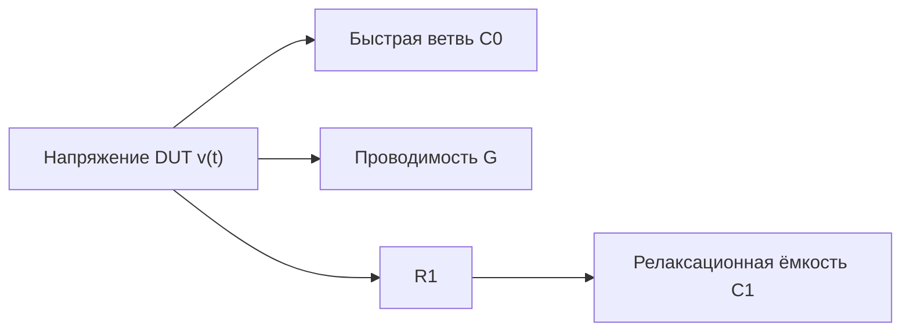

# Причинный физический наблюдатель QS/HF
## Модель, ограничения и проверка предсказательной силы

### 1. Назначение

Наблюдатель считается полезным не потому, что воспроизводит обучающую кривую, а потому, что предсказывает ранее не использованные результаты при известных воздействиях и подготовке. Комплект содержит исполняемый минимальный прототип такой процедуры.

Это офлайн-наблюдатель-модель, не драйвер B2910BL/Е7-12 и не готовая нелинейная модель MOS. Его задача — сделать проверяемыми причинность, историю состояния, заряд, энергию и независимое предсказание. Он дополняет обработку апертур, а не заменяет калибровку приборов.

### 2. Общая формализация

$
\dot x=F(x,u,\theta),\quad s=H(x,u,\theta),\quad y_k=\mathcal O_k[s;\eta_k]+\epsilon_k.
$

Наблюдатель включает:

1. физическую динамику DUT;
2. известную историю входного воздействия;
3. операторы регистрации;
4. процедуру подготовки начального состояния;
5. физические ограничения;
6. проверку на данных, не использованных для оценки параметров.

Параметры theta характеризуют объект, eta — наблюдение. Окна, задержки, полоса, фазовая привязка и калибровка не должны быть свободными ручками для улучшения совпадения. В текущем прототипе окна известны, а дополнительная передаточная функция тракта не оценивается: входные данные должны соответствовать этому приближению.

### 3. Минимальный физический объект

Выбрана пассивная линейная схема:



Три ветви параллельны. x — напряжение на C1; tau=R1*C1.

$
\dot x=(v-x)/\tau,
\qquad i=C_0\dot v+Gv+C_1\dot x.
$

Ограничения:

$
C_0>0,\quad C_1>0,\quad G>0,\quad \tau>0.
$

В программе они обеспечены логарифмической параметризацией и явными границами оптимизации. Это структурная причинная пассивность выбранного класса моделей, не доказательство, что реальный DUT относится именно к нему.

C1 нельзя автоматически объявлять ёмкостью ловушек: такую релаксацию могут давать разные механизмы. Для идентификации ловушек нужны дополнительные физические опыты и электростатика.

### 4. Вход и начальное состояние

Вход v(t) — фактическое напряжение на DUT, кусочно-линейное между зарегистрированными узлами. Не напряжение на внешнем входе Е7-12 до последовательного резистора.

Если используется реконструкция vDUT=vSMU-Rbias*ibias, её выполняют до подачи данных наблюдателю и учитывают неопределённость. Данный прототип считает вход известным без ошибки.

x0 задаётся один раз на полную последовательность run. При доказанном равновесии x0=v(0); иначе его нужно получить из отдельной подготовки или предыдущей причинной истории. Код не подгоняет x0 по проверочным данным, но и не способен подтвердить правдивость заданного x0. Заполнять его по наилучшему совпадению validation недопустимо.

Состояние непрерывно переносится через все участки и пропуски наблюдения. Сброс x перед каждой ступенью отсутствует. Кусочно-линейный вход исключает математически мгновенные скачки: фактический переход должен быть разрешён входными узлами.

Для участка v=v_a+s*t:

$
x(t)=x_a+st+A\tau(1-e^{-t/\tau}),
\quad A=(v_a-x_a)/\tau-s.
$

Используется точное распространение этого решения, без подбора временного шага ОДУ.

### 5. QS-оператор

$
y_j=\frac{1}{b_j-a_j}\int_{a_j}^{b_j}i(t)dt.
$

Для модели:

$
\int_a^b i\,dt=C_0[v(b)-v(a)]+C_1[x(b)-x(a)]+G\int_a^b v\,dt.
$

Это точное предсказание апертурного среднего, а не тока в середине окна. При наличии мёртвого времени модель продолжает эволюцию, но не объявляет пропущенное измеренным. Пропуски уменьшают возможность проверки модели и идентифицируемость быстрых компонент.

Входные токи должны соответствовать модели: фон fixture и инструментальный offset либо компенсированы отдельно, либо показана их пренебрежимость. Подгонять неизвестный фон как G без проверки нельзя.

### 6. HF-оператор

Для малосигнального стационарного линейного отклика той же схемы:

$
Y(\omega)=G+j\omega C_0+\frac{j\omega C_1}{1+j\omega\tau}.
$

Одни параметры одновременно предсказывают временные QS-данные и G/B. HF-проекция здесь — идеальное извлечение стационарной фундаментальной гармоники; конечный фильтр демодулятора и transient HF не реализованы.

Поддерживаются любые положительные частоты, в том числе 1 МГц. Демо использует несколько частот для информативности; это не приписывает Е7-12 многочастотность. Для реального Е7-12 передают только доступные записи 1 МГц.

Одна HF-точка может почти не содержать информации о медленном tau. Это отражается в чувствительности совместной модели, а не компенсируется выдуманным спектром.

В этой линейной модели HF не меняет медленное состояние. Поэтому она служит нулевой проверяемой гипотезой. Если реальный QS-отклик зависит от Vac при одинаковом v0, модель подлежит отклонению/расширению, а не косметической подгонке. Амплитудно-зависимая кинетика ловушек и нелинейное смешение здесь отсутствуют.

### 7. Баланс заряда

Из динамики следует:

$
Q_{port}=C_0\Delta v+C_1\Delta x+\int Gv\,dt.
$

Ток через проводимость — перенесённый, но не запасённый заряд. Внутреннее распределение по C0/C1 согласовано с одним терминальным током. Это баланс выбранной эквивалентной схемы, а не полный пространственный расчёт заряда полупроводника.

### 8. Энергия и пассивность

$
U=\tfrac12 C_0v^2+\tfrac12 C_1x^2,
$

$
vi=\dot U+Gv^2+\frac{C_1}{\tau}(v-x)^2.
$

Диссипация неотрицательна при положительных параметрах. Программа независимо вычисляет интеграл входной работы, диссипацию и изменение запасённой энергии по аналитическим формулам сегментов. Остаток записывается в balance_checks.csv.

Малый остаток подтверждает внутреннюю согласованность реализации, не заменяет независимую калориметрию и не доказывает полноту модели реального DUT. При отсутствии теплового канала диссипация является предсказанием модели, а не отдельно измеренным теплом.

### 9. Обучение и независимая проверка

Полные run помечаются train или validation. Используются только train для оценки theta. Validation не влияет ни на параметры, ни на состояние обучающих последовательностей. Затем выполняется свободное распространение состояния validation по входу и отдельно заданной подготовке, без коррекции по его выходным измерениям.

Критерии сравнения:

- нормированная RMSE: sqrt(mean(((prediction-measurement)/u)^2));
- доля остатков с модулем <=2;
- QS/HF-предсказания, сохранённые построчно;
- сингулярные числа якобиана обучающей задачи и его обусловленность.

Метрики здесь используют заданные стандартные неопределённости измерений, не полные предсказательные интервалы. Параметрическая неопределённость и ошибка входа не включены. Даже RMSE около единицы сама по себе не доказывает полноту модели: нужны структура остатков, отсутствие корреляции с входом, проверка на других протоколах и воспроизводимость.

Окончательные пороги допуска задают до просмотра validation. Код намеренно не выдаёт универсальный сертификат PASS. Если по validation выбрана другая модель, этот набор стал набором разработки; требуется новая окончательная проверка.

Режим --parameters загружает замороженные параметры и вообще не выполняет fit. Это удобно для действительно последующего опыта: сначала сохранить параметры, затем получить новый вход и предсказать выход без переоценки.

### 10. Формат данных

Каталог данных содержит:

**voltage.csv**

```csv
run,split,t_s,v_V,x0_V
r1,train,0,0,0
r1,train,0.01,0,0
r1,train,0.014,0.1,0
r1,train,0.1,0.1,0
```

Каждая строка — узел входного напряжения. В пределах run split и x0 одинаковы; время строго возрастает. x0_V — напряжение релаксационного состояния на начальном узле, не измеренный HF-результат.

**qs.csv**

```csv
run,a_s,b_s,i_A,u_i_A
r1,0.01,0.012,1e-8,2e-12
```

Токи — средние по апертуре; времена на той же шкале, что voltage.csv. Все окна должны находиться внутри заданной истории. u_i_A >0. Корреляции текущая целевая функция не учитывает.

**hf.csv** — необязателен

```csv
run,frequency_Hz,g_S,b_S,u_g_S,u_b_S
r1,1000000,1e-8,0.00628,1e-10,1e-10
```

Проводимости в Сименсах после штатных коррекций. Такая запись применима только если линейный стационарный эквивалент допустим для соответствующего протокола. При изменяющемся состоянии с разными HF-плато необходима расширенная, зависимая от состояния модель; текущая схема предсказывает одинаковый Y при одной частоте.

### 11. Запуск

```bash
python -m pip install numpy pandas scipy
python physical_observer.py --demo --data demo_data --out demo_results
python physical_observer.py --data measurements --out fitted
python physical_observer.py --data new_experiment --parameters fitted/parameters.json --out forecast
```

Выходы:

- parameters.json — замороженный набор физических параметров;
- qs_predictions.csv, hf_predictions.csv — наблюдаемое и предсказанное, с меткой train/validation;
- balance_checks.csv — заряд и энергетический баланс по последовательностям;
- report.json — модель, параметры, чувствительность и метрики.

Скрипт не управляет высоковольтной установкой. Прежние условия безопасного подключения Е7-12/B2910BL сохраняются; 20 кОм не включено повторно внутрь DUT-модели, поскольку входом уже является напряжение на DUT.

### 12. Развитие модели

Следующие расширения должны вводиться только с новыми проверками:

1. приборный h(t) и реальный вес апертуры из независимой характеристики;
2. нелинейная Qfast(v), общий положительный закон диссипации;
3. кинетика заселённости 0<=f<=1, с согласованными потоками заряда;
4. зависимость переходных скоростей от Vac, частоты, температуры и поверхностного потенциала;
5. явные цепи bias, fixture, тепловой/оптический каналы;
6. предсказательные интервалы с корреляциями входов и параметров;
7. выбор новых воздействий по чувствительности к остающимся ненаблюдаемым направлениям.

Добавление параметра оправдано улучшением независимого предсказания и физической согласованности, а не только уменьшением обучающего остатка.

### 13. Источники

- MathWorks. Simulate and Predict Identified Model Output. Проверка на данных, не использованных для оценки: https://www.mathworks.com/help/ident/ug/definition-simulation-and-prediction.html
- Linköping University. System Identification: Practical Aspects. Свежие проверочные данные и анализ остатков: https://www.rt.isy.liu.se/en/student/graduate/idkurs/lecture4-2x4.pdf
- M. Kuhn. A quasi-static technique for MOS C–V and surface state measurements. Solid-State Electronics 13 (1970), 873–885. DOI: 10.1016/0038-1101(70)90073-0.
- M. Kuhn, E. H. Nicollian. Nonequilibrium Effects in Quasi-Static MOS Measurements. J. Electrochem. Soc. 118 (1971), 370–373. DOI: 10.1149/1.2408053.
- C. N. Berglund. Surface states at steam-grown silicon-silicon dioxide interfaces. IEEE TED ED-13 (1966), 701–705. DOI: 10.1109/T-ED.1966.15827.
- E. H. Nicollian, A. Goetzberger. The Si–SiO2 Interface—Electrical Properties as Determined by the Metal-Insulator-Silicon Conductance Technique. BSTJ 46 (1967), 1055–1133. DOI: 10.1002/j.1538-7305.1967.tb01727.x.

Уравнения пассивной RC-модели и энергетическое тождество выведены в этом документе. 
