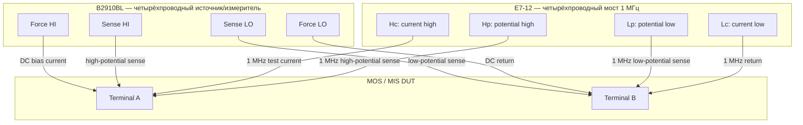

# Квазистатическая C–V и 1 МГц иммитанс

## комплект

`qscv_final.py` объединяет апертурную обработку QS, анализ хвоста, явную экспоненциальную модель, пропуски, частичный бюджет неопределённости, forward/reverse и привязку HF-данных. Это **офлайн-анализатор**, не SCPI-драйвер: он не управляет приборами и не гарантирует аппаратную полноту регистрации заряда.


## Система и границы 

По данным, Е7-12 имеет встроенную цепь разделения AC/DC и штатный вход внешнего смещения через 20 кОм,1 МГц и внешнее смещение до 200 В. Полярность, ограничения, мощность резистора и безопасное подключение по паспорту экземпляра НЕ ЗНАЧАТСЯ. Отдельный внешний RF bias-tee недобавляется.



```text
                 B2910BL                              E7-12
          ┌──────────────────────────┐        ┌──────────────────────────┐
          │  Force HI ───────────────┼──────► │ Terminal A ◄──────── Hc  │
          │  Sense HI ───────────────┼──────► │ Terminal A ◄──────── Hp  │
          │                          │        │                          │
          │  Sense LO ───────────────┼──────► │ Terminal B ◄──────── Lp  │
          │  Force LO ───────────────┼──────► │ Terminal B ◄──────── Lc  │
          └──────────────────────────┘        └──────────────────────────┘
                                   │                         │
                                   └────────── DUT ──────────┘
                                     Terminal A ── Terminal B
Время (общая шкала приборов)

              подготовка / установление       QS-переход и интегрирование
              ============================    =========================================
V_DUT         Vprev ------------------------> Vnext (plateau)
              ^                               ^
              |                               |
              |  E7-12: 1 MHz AC ON           |  B2910BL: апертуры тока
              |  HF-измерения на plateau      |  [a1,b1] [a2,b2] ... [aN,bN]
              |                               |
              +-------------------------------+--------------------------> t
                                              t0 (физическое начало перехода)

QS-результат: Q = sum_j (I_j - L_j)*(b_j-a_j),  C_sec = Q / (Vnext - Vprev)
HF-результат: Y = G + jB,  Cp = B / (2*pi*f),  только внутри plateau
```

Рисунок функциональный: guard, sense, общие потенциалы и реальная мостовая схема не определяются этим рисунком. Не нужно предполагать, что SMU — мост того же типа, что LCR. Важны функции source/measure и реальные характеристики.

## Два масштаба одного опыта


$V_{DUT}(t)=V_0(t)+\sqrt{2}V_{ac,rms}\cos(2\pi ft).$

DUT работает под медленным смещением и малой ВЧ-модуляцией одновременно. QS и HF описывают разные составляющие отклика; их равенство не требуется, «несовместимость моделей» не является членом погрешности. Модуляция может менять заселённость ловушек, средний ток, нагрев и релаксацию. QS при AC ON — самостоятельная измеряемая величина, не автоматически результат AC OFF.

Медленный канал регистрирует ток всей DC-цепи с учётом паразитных ветвей. ВЧ-канал выдаёт комплексную проводимость Y=G+jB; при положительном ёмкостном B:

$
C_{p,HF}=B/(2\pi f),\quad D_p=G/B.
$

Cp — параллельный эквивалент; Cs=-1/(omega*Im Z) — последовательный, смешивать их нельзя.

## Что делает резистор 20 кОм

Для DC/низкочастотной сосредоточенной модели с единственным последовательным R:

$
V_{DUT}(t)=V_{SMU}(t)-R I_{bias}(t).
$

Знак тока должен соответствовать направлению от SMU к DUT. Уравнение справедливо только если измеренный ток действительно течёт через этот R, а дополнительные падения/ветви пренебрежимы или учтены. Установившиеся напряжения:

$
\Delta V_{DUT}=\Delta V_{SMU}-R(I_{after}-I_{before}).
$

Для масштаба: 1 мкА даёт падение 20 мВ. Для идеального конденсатора tau=R*C: 1 нФ даёт 20 мкс, 10 нФ — 200 мкс. Это оценки одной RC-компоненты, не гарантированная форма всего отклика.

R может растянуть импульс, но не гарантирует его попадания в апертуры. Например, при tau=20 мкс спустя 50 мкс остаётся только exp(-2.5), около 8.2% экспоненциального заряда. Интервал выборок нельзя выдавать за длительность апертуры.

На HF резистор входит в DC-питающую ветвь, которая может шунтировать DUT в зависимости от импеданса SMU и внутренней развязки Е7-12. Нельзя считать R последовательным выходным сопротивлением AC-источника. Для de-embedding нужна действительная схема/калибровка сети, а не одна номинальная величина R.

Нельзя соединять remote sense SMU за R, не проверив допустимость такого подключения, устойчивость и смысл измерения: обратная связь может менять заданную динамику и ток. В данной версии стандартный вариант — пассивная штатная bias-ветвь и известное/измеренное напряжение DUT.

## Калибровки и поправки

Заводская/сервисная калибровка, self-calibration, штатные процедуры Е7-12 и компенсация fixture учитываются как выполненные коррекции в определённой опорной плоскости. Их нельзя повторно вычитать. Остаются остаточные неопределённости, изменение цепи после калибровки и неизвестные динамические эффекты.

Отдельно контролируют инструментальный gain/offset и drift; временные окна/полосу/перегрузку; внешние токи fixture и bias-ветви; модель DUT; алгоритм интегрирования. Не все эффекты сводятся к независимым эквивалентным ёмкостям. Blank измеряется в согласованной конфигурации. Если фон уже включён в leak_A, второй раз его не вычитают.

## QS: заряд за шаг

Переход должен иметь оговорённое начальное состояние и конечное окно наблюдения:

$
Q_{obs}=\sum_j(\bar I_j-\bar L_j)(b_j-a_j),\quad C_{sec}=Q/\Delta V_{DUT}.
$

Средние токи относятся к реальным апертурам [a,b]. Это секущая Q–V на шаге, относимая к его середине, не точная производная. Знаки сохраняют, abs не применяют. Расчёт I/(Delta V / dwell) для одиночного измерения внутри ступени не используется.

Модель предполагает прямоугольное весовое окно. Иной вес измерителя требует соответствующей модели. Полный заряд содержит также пропущенное начало, межапертурные промежутки и хвост после последнего окна. Нулевой поздний ток не доказывает регистрацию начального импульса.

## Подготовка и хвост

pre_settled=true допустим только после документированной подготовки до шага. Первый шаг каждой ветви по умолчанию должен иметь false, если отдельное установление не подтверждено. Скрипт сохраняет его для диагностики, но исключает из строгих сравнений. Предыдущий шаг помогает проверить начальное состояние; весь его ток нельзя произвольно вычитать из следующего.

В последних N окнах скорректированный ток аппроксимируется B+S(t-tmean). Критерий:

$
|B|+1.96u(B)\le I_{limit},\quad |S|+1.96u(S)\le S_{limit}.
$

Это приближённый нормальный тест с независимыми весами, не доказательство исчезновения всех медленных процессов. Ток ниже порога может иметь значимый интеграл на большом времени. Фон leak_A нужно оценивать независимо или по обоснованной процедуре: весь хвост не обязательно является утечкой.

## Экспоненты и ловушки

Опции --model none|exp1|exp2 задают модель явно:

$
i(t)=B+\sum_m A_m e^{-t/\tau_m}.
$

Fit использует апертурное среднее модели:

$
\bar i_j=B+\sum_m\frac{A_m\tau_m}{b_j-a_j}(e^{-a_j/\tau_m}-e^{-b_j/\tau_m}).
$

fits.json содержит параметры, локальную ковариацию, reduced chi-square, обусловленность и компонентные заряды A*tau. Постоянный B не интегрируется до бесконечности. Оставшийся экспоненциальный хвост записывается, но автоматически к результату не прибавляется.

Fast/slow не равно автоматически capacitance/traps. Медленный ток дают RC тракта, генерация носителей, абсорбция, контакты, drift. Быстрые ловушки могут быть частью fast. Для идентификации нужны эталонные RC, одинаковые подготовки с разной заселённостью, вариации длительности/шага/температуры/Vac и независимая электростатика. Пропущенный быстрый импульс нельзя однозначно восстановить из медленного хвоста. Для Dit недостаточно делить A*tau на q и площадь.

Fit локальный, без гарантии глобального решения; близкие tau и короткая запись делают параметры неоднозначными. Код не выбирает физическую модель автоматически.

## Мёртвое время и timer

Период timer не равен апертуре. Требуются реальные source/acquire trigger, count/delay/period, NPLC/aperture, autozero/autorange, диапазон, source settling, статусы и семантика timestamps именно установленной версии. Нельзя предполагать отсутствие пропусков триггеров при занятости измерителя. Время ответа VISA не является временем физического перехода.

Режимы --gap-mode:

- reject: помечает GAPS_UNACCOUNTED; Q остаётся только зарегистрированным.
- bound: с --gap-current-bound-A выдаёт отдельную границу |Qgap| <= Ibound*Tgap, не заполняя пропуски. Граница должна покрывать возможные пики скорректированного тока.
- model: интегрирует выбранную exp1/exp2 по пропускам. Результат модельно зависим; условная неопределённость fit не покрывает ошибку выбора модели.

Изменение фазы acquisition в повторных циклах может помочь только при воспроизводимой подготовке. Интерполяция двух поздних средних не восстанавливает неизвестный ранний пик. Включение acquisition до source transition требуется проверить экспериментально, а не обещать без диаграмм.

## ВЧ и входной тракт SMU

SMU — не голый АЦП, но ни малая скорость выдачи отсчётов, ни наличие фильтров не задают количественного подавления 1 МГц в данном диапазоне. Для идеального прямоугольного окна |H|=|sin(pi*f*T)/(pi*f*T)|; реальный тракт, нелинейность, перегрузка и рассогласование фаз требуют проверки. Частота выдачи результатов не равна полосе входа.

Проверить AC OFF/ON на blank и пассивном RC, несколько Vac, частот, апертур и фаз. Затем повторить на DUT при одинаковой подготовке. Изменение QS на DUT может быть реальной физикой совместного возбуждения. Термин noise shaping оставляют для установленного механизма, не любого изменения спектра.

## Неопределённость

Реализован частичный бюджет для зарегистрированного заряда:

$
u^2(Qobs)\approx\sum_j[w_j^2(u_{I,j}^2+u_{L,j}^2)+(\bar I_j-\bar L_j)^2u^2(w_j)]
+Tobs^2(u_{I,common}^2+u_{L,common}^2)+Qobs^2u_{clock,rel}^2.
$

Независимые компоненты задаются по окнам, общие — отдельными параметрами. Не включать один источник дважды. u_dt_s не описывает полностью сдвиг окна относительно резкого импульса; общие границы и коррелированный шум требуют матриц ковариаций/Monte Carlo.

u_c_observed_terms_F включает только этот u(Qobs) и заданное u_dv_V с предположением независимости. Не включает неизвестный хвост, ошибку модели пропусков, все gain-компоненты и HF-бюджет. Qobs и модельный Qgap коррелированы; их u нельзя просто складывать квадратично. Для полного бюджета повторно подгонять и интегрировать в совместном Monte Carlo.

При восстановлении напряжения за R:

$
u^2(V_D)\approx u^2(V_S)+I^2u^2(R)+R^2u^2(I)+\text{ковариационные члены}.
$

Код НЕ подменяет этот бюджет фиктивным числом. --u-r-bias-rel записывается в metadata; его перенос в неопределённость Delta V делает пользователь с учётом корреляции общего R в обоих концах шага. --u-dv-V следует задать как уже рассчитанную неопределённость действительного приращения DUT.

## HF, временная привязка и сравнения

HF-окно с запасом --u-sync-s должно целиком находиться на подтверждённом plateau. Этот параметр — граница ошибки выравнивания, не стандартная u. Измерение HF на plateau и QS за переход связано общим шагом, но не тождественно одному времени: QS относится к секущей между Vprev/Vnext, HF — к своему фактическому DC. Код не вычитает CpHF из Cqs и не объявляет остаток ловушками.

joint_records сохраняет HF-проверки отдельно от QS status. paired_summary допускает только HF, прошедшие проверки, и QS с подготовкой, хвостовым тестом и без пропусков. Модельно заполненные пропуски не становятся автоматически строгими результатами. Разные частоты/Vac/DC не усредняются вместе.

forward_reverse.csv сопоставляет только допущенные QS-шаги внутри одного run, интерполируя reverse в области перекрытия без экстраполяции. Неопределённость интерполяции не вычисляется. Разность не равна универсально заряду ловушек.

## Входные CSV

### acquisition.csv

Обязательные столбцы:

```
run,direction,step,v_before_V,v_after_V,a_s,b_s,i_A,u_i_A,leak_A,u_leak_ind_A,u_dt_s,pre_settled
```

Несколько строк на шаг — нормально. a/b: секунды относительно физического начала перехода. v_before/after — реальные установившиеся напряжения DUT, НЕ автоматически настройки SMU. Токи в А, u_dt в с; pre_settled — true/false. direction: forward/reverse.

При --derive-dut-voltage нужны дополнительные столбцы vsource_before_V,vsource_after_V,ibias_before_A,ibias_after_A. Тогда v_before/after заменяются на Vsource-R*Ibias. Обязательные исходные столбцы напряжения всё равно присутствуют, например с исходными оценками. Копии до замены следует хранить в исходном CSV. Реконструкция не добавляет несуществующий высокоомный sense и не измеряет динамическое V(t).

### timing.csv

```
run,direction,step,qs_start_s,qs_end_s,plateau_start_s,plateau_end_s,v_plateau_V,ac_state
```

Времена общие для приборов, а не относительные a/b. qs_start — согласованный t0, qs_end — граница общей записи шага, включающей plateau. Пользователь обязан проверить привязку всех апертур к общей записи. Plateau означает пригодный DC-bias; состояние DUT может продолжать релаксировать.

### hf.csv

```
run,direction,step,hf_start_s,hf_end_s,frequency_Hz,g_S,b_S,vac_rms_DUT_V,vac_rms_source_V,vdc_DUT_V
```

G/B после штатных компенсаций в определённой плоскости. Vac_DUT — измеренное/обоснованное, не выдуманное из 20 кОм. Если прибор не выдаёт эти данные автоматически, нужен проверенный внешний способ регистрации; интерфейс Е7-12 здесь не предполагается.

## Запуск

```bash
python -m pip install numpy pandas scipy
python qscv_final.py --demo --model exp2 --gap-mode model --output demo
python qscv_final.py --acq acquisition.csv --timing timing.csv --hf hf.csv --r-bias-ohm 20000 --model exp1 --gap-mode reject --output result
```

Для reconstruction добавить --derive-dut-voltage. Параметры хвоста: --tail-points, --tail-limit-A, --slope-limit-A-s. Неопределённости: --u-current-common-A, --u-leak-common-A, --u-clock-rel, --u-dv-V. Диагностика HF: --max-vdc-error-V, --max-ac-load-error-rel, --u-sync-s.

Демо — аналитическая сумма RC-компонент 1 нФ и 0.2 нФ с известной утечкой и шумом; оно содержит мёртвое время. Это НЕ симулятор аппаратуры. Строгие paired_summary/forward_reverse могут быть пустыми из-за пропусков/отсутствия reverse — это ожидаемо, не ошибка и не нулевой гистерезис.

Выходы: steps.csv, fits.json, joint_records.csv, paired_summary.csv, forward_reverse.csv, metadata.json. Ни один флаг не является сертификатом метрологической аттестации.

## Безопасность

Работу до 200 В определяет вся цепь, а не только SMU: паспорт входа Е7-12, полярность, ток, резистор, кабели, изоляция и DUT. Проверить штатное отключение внутреннего bias, если требуется. DC-block не отменяет переходных токов. Нужны ограничение тока, безопасный разряд и защита от остаточного заряда. SMU должен корректно поглощать ток разряда в разрешённой области. Не подключать к мостовым/guard-выводам заземлённый осциллограф без анализа общих потенциалов.

### Методические ограничения

- **NIST**, “Rapid and Accurate C–V Measurements”: https://tsapps.nist.gov/publication/get_pdf.cfm?pub_id=921598  
  Паразитные элементы измерительной системы, необходимость separate leakage measurement и point-by-point leakage correction. 

- **Schmitz et al.**, “Leakage current correction in quasi-static C–V measurements,” *ICMTS 2004*: https://ris.utwente.nl/ws/files/5330666/schmitz_hof.pdf  
  Коррекция тока утечки затвора в QSCV. 

- **Wagner and Berglund**, “A Simplified Graphical Evaluation of High-Frequency and Quasistatic Capacitance–Voltage Curves,” *Review of Scientific Instruments*, vol. 43.  
  Совместный анализ HF- и QSCV-кривых. 

- **“Using the Quasistatic Method for MOS Measurements,”** *Review of Scientific Instruments*, vol. 44, no. 2, pp. 200–…, 1973.  Практическая реализация QSCV и оценка точности вблизи midgap.


## Источники и происхождение параметров

- M. Kuhn, Solid-State Electronics 13 (1970), 873–885: https://doi.org/10.1016/0038-1101(70)90073-0
- Keysight B2900B/BL Programming Guide: https://www.keysight.com/us/en/assets/9921-01284/programming-guides/B2900B-BL-Series-Precision-Source-Measure-Unit-Programming-Guide.pdf
- Keysight SCPI Reference: https://www.keysight.com/us/en/assets/9921-01285/programming-guides/B2900B-BL-Series-Precision-Source-Measure-Unit-SCPI-Command-Reference.pdf
- Описание Е7-12 ТО (1 МГц, внешнее смещение до 200 В)
